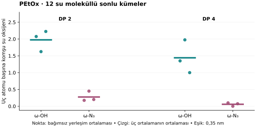
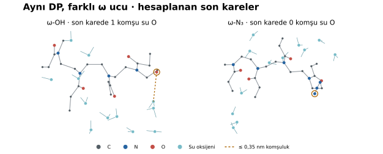
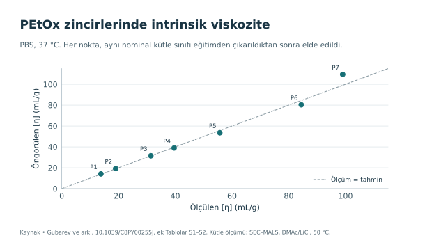

# PEtOx zincir popülasyonu ve intrinsik viskozite

## PEtOx uçlarında su nerede bulunuyor?

**Executed MD · PEtOx termini with 12 waters** örneğini aç. DP 2 veya 4 seçerek α-metil grubunu sabit tut, ω-hidroksilin oksijeni ile ω-azidin en dış azotunun yakınındaki suyu karşılaştır. Her nokta ayrı bir başlangıç zinciri ve su yerleşiminden elde edilen ortalamadır.

DP 4’te 0,35 nm içindeki su oksijeni sayısı üç başlangıçta ortalama **1,442 (OH) ve 0,058 (N₃)**. Her sistem bir zincir ve 12 sudan oluşuyor. İkişer pikosaniyelik gözlem aralığında ölçülen farkın sıvı suda korunduğu henüz bilinmiyor. **Yorum için:** Terminal atoma ek olarak azidin üç azotundan herhangi birine komşu olan benzersiz su sayısı da raporlansın mı?

Aynı tohumla oluşturulan DP 4 sistemlerinin son kareleri iki boyuta yansıtıldı. Halkalı atom ω grubunun sayım noktasıdır; kesikli çizgiler bu atoma yakın su oksijenlerini gösterir. Polimer hidrojeni çizimde gizlendi. Tek karede görülen sayı ile bütün yörünge ortalaması farklı olabilir.

[Model, yeniden çalıştırma ve bilgisayarda incelenebilir son yapılar](docs/PEtOx_MD.md)

PBS içinde PEtOx için [η]–M ilişkisi sıcaklıkla nasıl değişiyor?

## Uygulamada incele

PEtOx viskozite örneğinde 37 °C seç. Her adımda bir molar kütle sınıfının tamamen çıkarıldığı tabloyu incele. Ardından 55 °C seçip veri sayısının ve hatanın değişimini karşılaştır.

## Örnek sonuç

37 °C’de yedi sınıfta medyan mutlak bağıl hata %2,33, P90 %7,12. 55 °C’de dört sınıfta medyan %10,91. Deneysel seri toplam beş sıcaklıkta 26 viskozite ölçümü içeriyor.

## Kimyasal yorum

SEC–MALS için DMAc/LiCl ortamı ile viskozite ölçümündeki PBS ayrı alanlar. Tek çalışmadaki kütle sınıflarının sınanması laboratuvarlar arası aktarımı ölçmez. Geniş kütle dağılımlarına ilişkin hesap için uygun bileşen K ve a katsayıları gerekir.

[Bilimsel yöntem ve veri](docs/PEtOx_VISCOMETRY.md) · [Proje ve kullanım](README.md) · [Tek proje kaynak arşivi](../downloads/polymer-chain-lab-0.4.0.zip) · [Tüm projeler](../README.md)
