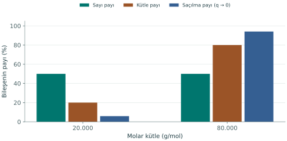

# Polymer Chain Lab

Aynı zincir popülasyonunda sayı ve kütle ağırlıklı ortalamalar nasıl farklılaşır?

## İki bileşenli doğrusal zincir popülasyonu

**Girdiler** — 20.000 ve 80.000 g/mol kütlelerde eşit sayıda zincir. Tekrar kütlesi 100 g/mol, uç düzeltmesi 0 g/mol. Gaussian modelinde kontur artışı 0,25 nm/tekrar, Kuhn uzunluğu 1 nm.

**Hesaplanan sonuç** — Mₙ = 50.000 g/mol, Mw = 68.000 g/mol, Đ = 1,36 ve DPₙ = 500. Sayı ağırlıklı RMS jirasyon yarıçapı 4,564 nm, kütle ağırlıklı RMS değer 5,323 nm.

**Modelin kapsamı** — Kütleden DP hesabı (M − Muç)/M₀ ilişkisini kullanır. Zincir boyutları girilen sertlik ve kontur artışına bağlıdır. Örnek dağılım sentetiktir.

**İncelerken** — Ölçtüğün SEC dağılımının sütunları, sayı/kütle temeli ve uç grup düzeltmesi bu forma uyuyor mu?

Kurulumdan sonra uygulamayı `polymer-chain-lab` komutuyla açabilirsin. [Kurulum ve kullanım](README.md) · [Model veya veri aktarımı](docs/SCIENCE.md) · [Doğrulama](docs/VALIDATION.md)

[Bu projenin sürüm 0.2.0 kaynak kodunu ZIP olarak indir](../downloads/polymer-chain-lab-0.2.0.zip?raw=true)
