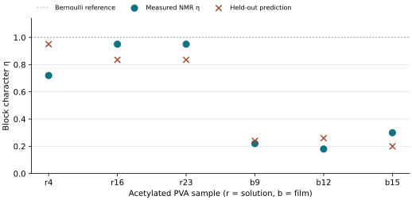
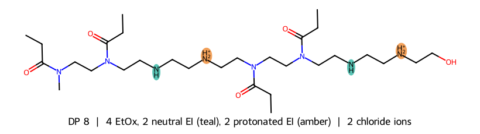
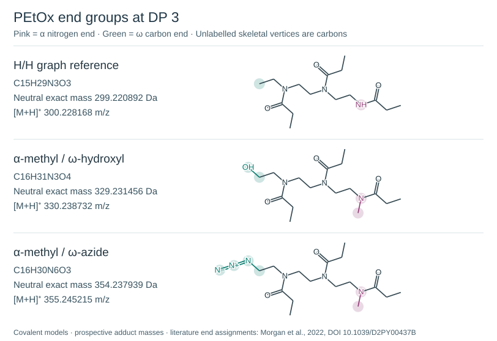

# PEtOx uç grupları ve PVA dizisi

Aynı tekrarlardan oluşan iki zincirin kütle spektrumu neden farklı olabilir?

## Altı deneysel PVA sınıfında dizi sınaması

**PVA · 2026 NMR and independent sample holdout** örneğinde nominal asetat oranları birbirine yakın rAcPVOH16 ve bAcPVOH15 için ölçülen η değerleri 0,95 ve 0,30’dur. Aynı sırayla ortalama OH dizi uzunlukları 6,1 ve 22,3 tekrardır. Altı deneysel sınıfı sırayla dışarıda bıraktığımızda hazırlama yoluna dayalı ortalamanın mutlak hatası 0,110 η birimi, rastgele dizi varsayımının hatası 0,447 η birimidir. Bu sonuç tek yayının karşılaştırmasıdır. İkinci ekranda iki grubun η değerini koruyup model bileşimini %15 asetata eşitle. Hesaplanan karışık diyad oranları %24,225 ve %7,650 olur. [Ölçülen veriler, Tablo 1](https://doi.org/10.1021/acsapm.6c00317)

## WBPU için PEtOx/EI karışım bileşeni

**WBPU blend partner · PEtOx/EI protonation** örneğinde zinciri α-metilden ω-hidroksile doğru düzenle. E sağlam EtOx, I nötr etilenimin ve P bir proton kazanmış etilenimin birimidir. `EEIPEEIP` için sekiz tekrarın dördü hidrolize, bu dört aminin ikisi protonlanmıştır. Zincir yükü +2, iki klorür eklenince toplam yük sıfırdır. I ve P yerlerini değiştirerek aynı bileşimde hangi atomların farklı kimyasal çevreye geçtiğini incele. Su koordinasyonu ve karışım davranışı için ayrı bir yörünge ve numune kaydı gerekir. [Yöntem](docs/MICROSTRUCTURE.md)

## Uygulamada incele

PEtOx için **same DP, three end groups** örneğini seç. Zincir başındaki azota bağlı metili ve zincir sonundaki karbona bağlı OH veya azidi çizim üzerinde incele. **Poval 217** örneğinde ¹³C-NMR diyadlarıyla eş hidroliz derecesindeki rastgele diziyi karşılaştır.

## Örnek sonuç

DP = 6 için [M+H]⁺ hedefleri H/H örneğinde 597,433410, α-Me/ω-OH için 627,443974, α-Me/ω-N₃ için 652,450457 m/z. Poval 217 diyadlarından %88,1 OH ve yaklaşık 20,02 OH birimlik ortalama ardışık dizi uzunluğu bulunur.

## Kimyasal yorum

Kütleler teoriktir. Uç grup konumunu deneysel olarak tayin etmek için tanısal fragmanları ve spektrumu incele. NMR diyadları uyumlu bir zincir popülasyonunu sınırlar.

[Bilimsel yöntem ve veri](docs/SCIENCE.md) · [Proje ve kullanım](README.md) · [Tek proje kaynak arşivi](../downloads/polymer-chemistry-lab-0.4.0.zip) · [Tüm projeler](../README.md)
