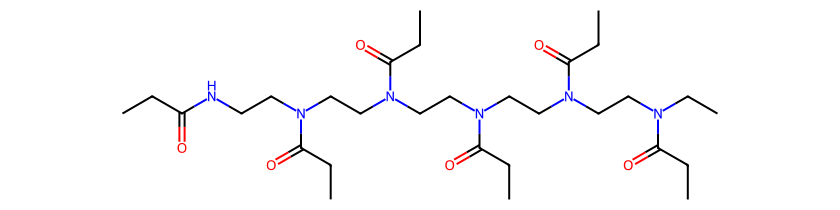

# Polymer Chemistry Lab

Tekrar birimindeki iki bağ noktası birleştirilince hangi sonlu molekül oluşur?

## PEtOx, altı tekrar

**Girdiler** — A = `[*:1]CCN(C(=O)CC)[*:2]`, dizi `AAAAAA`, iki uçta H.

**Hesaplanan sonuç** — C₃₀H₅₆N₆O₆. Ortalama molar kütle 596,814 g/mol, kesin molekül kütlesi 596,426134 Da. Atom–bağ gösterimi 42 ağır atom içerir.

**Modelin kapsamı** — H/H uçları bu örneğin kimyasal varsayımıdır. Gerçek başlatıcı ve sonlandırıcı kalıntıları için uç kimyası değiştirilmelidir. Belirtilmemiş stereomerkezlerden taktisite çıkarılmaz. Tek bir molekülün kütlesinden numunenin Mₙ değeri belirlenemez.

Şekilde her yapı dört tekrar içerir. Yukarıdaki sayısal örnek altı tekrarlı PEtOx içindir.

**İncelerken** — Hangi gerçek uç gruplarını, tekrar birimini ya da açık A/B dizisini ilk olarak görmek istersin?

Kurulumdan sonra uygulamayı `polymer-chemistry-lab` komutuyla açabilirsin. [Kurulum ve kullanım](README.md) · [Model veya veri aktarımı](docs/SCIENCE.md) · [Doğrulama](docs/VALIDATION.md)

[Bu projenin sürüm 0.2.0 kaynak kodunu ZIP olarak indir](../downloads/polymer-chemistry-lab-0.2.0.zip?raw=true)
