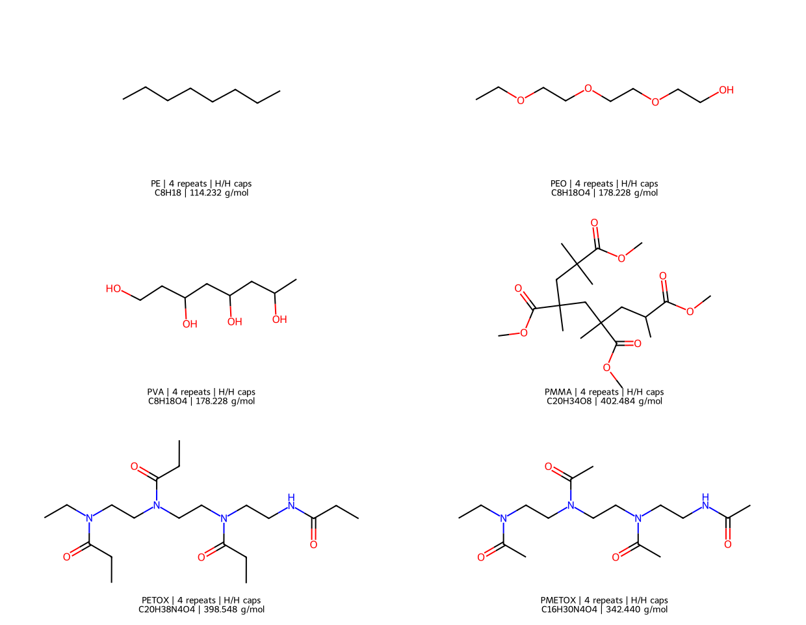

# Polymer Chemistry Lab

**Explicit repeat connectivity, finite chains, sequence chemistry, and end-group-aware mass bookkeeping.**

A local scientific application by **Burhan Beycan** for a polymer-chemistry research workflow. It builds atom/bond graphs from mapped polymerized repeat units and connects to [Polymer Research Workbench](https://github.com/burhanbeycan/polymer-research-studio). No PolyChemMD installation is required.

Version **0.2.0** implements a bounded molecular graph constructor. It does not infer polymerization reactions or predict material properties from chemical names. The GUI displays actual connectivity, with heteroatoms, multiple bonds, stereochemical wedge/dash cues and repeat lineage. Coordinates describe a 2D drawing, not an equilibrium conformation.

## Install and run

Use Python 3.10 or newer. Clone the runtime and this laboratory into sibling directories:

```bash
git clone https://github.com/burhanbeycan/polymer-research-studio.git
git clone https://github.com/burhanbeycan/polymer-chemistry-lab.git
python -m venv .venv
```

Activate using `source .venv/bin/activate` on macOS/Linux or `.venv\Scripts\Activate.ps1` on Windows PowerShell, then:

```bash
python -m pip install ./polymer-research-studio ./polymer-chemistry-lab
polymer-chemistry-lab
```

The local GUI opens at **http://127.0.0.1:8771**. Use `--no-browser` to suppress browser opening. For integrated use, install the other laboratories in the same environment and run `polymer-studio`. RDKit is an external chemistry dependency installed from PyPI; the software is not itself published to PyPI.

## Chemically explicit inputs

Enter the **already polymerized repeat**, with exactly two neutral dummy ports: `[*:1]` and `[*:2]`. Endpoint 2 of each unit joins endpoint 1 of the next. Every unit has the same declared orientation; the constructor does not decide regioselectivity. Both terminal ports are replaced by **H atoms**. These are computational graph caps. Real initiator and termination groups must be specified in a future end-group model before interpreting a synthetic sample.

| Preset | Polymerized mapped repeat | Repeat contribution |
|---|---|---|
| PE | `[*:1]CC[*:2]` | C₂H₄ |
| PEO | `[*:1]CCO[*:2]` | C₂H₄O |
| PVA | `[*:1]CC(O)[*:2]` | C₂H₄O |
| PMMA | `[*:1]CC(C)(C(=O)OC)[*:2]` | C₅H₈O₂ |
| PEtOx | `[*:1]CCN(C(=O)CC)[*:2]` | C₅H₉NO |
| PMeOx | `[*:1]CCN(C(=O)C)[*:2]` | C₄H₇NO |

PEtOx contains an N-propionyl-substituted ethyleneimine backbone; its cyclic monomer is not used as a polymer repeat. PEO and PVA illustrate why identical elemental formulas do not establish identical polymer chemistry. The H-capped PEO model has one terminal hydroxyl; PVA carries a hydroxyl on each repeat.

The sequence `AAAAAA` constructs six A units. `AAABBB` and `ABABAB` contain the same numbers of A and B but have different directed dyads and connectivity. These are individual explicit chains, not random-copolymer ensembles. Bounds are 64 units and 512 non-port atoms. Stereochemistry is retained where explicitly encoded; leaving it unspecified does not produce an atactic population.



The gallery shows H/H-capped finite graphs. Unspecified stereocentres are not an atactic ensemble. Reproduce it with `python scripts/generate_gallery.py`.

## Mass bookkeeping and connected calculations

The repeat contribution excludes the two terminal H atoms:

\[
M_{\mathrm{chain}}=\sum_i M_{\mathrm{repeat},i}+2M_H.
\]

Formula, average molar mass and exact molecular mass are reported separately. A finite molecule's mass is not a sample's measured Mn or Mw. For homopolymers, the explicit handoff to Chain Lab transfers only the average repeat mass and H/H end correction. It does not invent a measured MWD, contour increment, persistence length or Kuhn length. Mixed-repeat chains have no automatic one-repeat mapping.

## Verify and inspect

```bash
cd polymer-chemistry-lab
python -m unittest discover -s tests -v
```

The numerical module runs without the workbench. Read [SCIENCE](docs/SCIENCE.md), [REFERENCES](docs/REFERENCES.md) and [VALIDATION](docs/VALIDATION.md) for definitions, verification evidence and limits. Source code and tests distinguish our attachment/sequence protocol and chemistry ledger from RDKit's molecular parsing, graph substitution, mass and depiction algorithms. Developed with AI assistance; MIT license.
