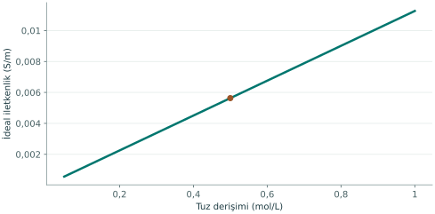

# Polymer Electrolyte Lab

İyonların izleyici difüzyon katsayıları iletkenlik için hangi ideal referans değerini verir?

## Bağımsız hareket eden 1:1 tuz iyonları

**Girdiler** — T = 298,15 K, tuz derişimi 0,5 mol/L, D₊ = 10⁻¹² m²/s, D₋ = 2 × 10⁻¹² m²/s.

**Hesaplanan sonuç** — Nernst–Einstein iletkenliği 0,005633 S/m = 0,056331 mS/cm. Bağımsız iyon varsayımı altında katyon akım payı 1/3.

**Modelin kapsamı** — Korelasyonları incelemek için kolektif Onsager katsayıları ve tanımlı bir referans çerçevesi gerekir. Yukarıdaki izleyici difüzyonlarından gerçek polimer elektrolitin korelasyonları belirlenemez.

**İncelerken** — Veri setindeki difüzyon katsayıları hangi iyonlara, hangi sıcaklığa ve hangi referans çerçevesine ait?

Kurulumdan sonra uygulamayı `polymer-electrolyte-lab` komutuyla açabilirsin. [Kurulum ve kullanım](README.md) · [Model veya veri aktarımı](docs/SCIENCE.md) · [Doğrulama](docs/VALIDATION.md)

[Bu projenin sürüm 0.2.0 kaynak kodunu ZIP olarak indir](../downloads/polymer-electrolyte-lab-0.2.0.zip?raw=true)
