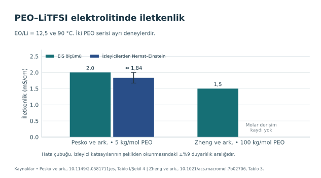

# PEO–LiTFSI reçetesi, EIS ve izleyici difüzyonu

Aynı EO:Li oranındaki iki elektrolitte hangi ölçümler birlikte kullanılabilir?

## Uygulamada incele

Pesko ve Zheng örneklerinde EO:Li = 12,5 ve 90 °C sabittir. PEO molar kütlesini, ısıl geçmişi, derişim kaynağını ve veri konumunu karşılaştır. Kendi filminde EIS direnç, kalınlık ve elektrot alanı ile çalışabilir.

## Örnek sonuç

5 kg/mol PEO örneğinde EIS iletkenliği 2 mS/cm. Grafikten yaklaşık okunan izleyici katsayılarıyla σNE ≈ 1,84 mS/cm. 100 kg/mol PEO örneğinde EIS 1,5 mS/cm ve izleyici oranı 0,192. Bu ikinci örnek için eşleşmiş bir molar derişim bulunmadığından σNE hesaplanmıyor.

## Kimyasal yorum

Numune tanımı ve sıcaklığı formülasyon, izleyici ve EIS için eşleşmeli. σEIS/σNE oranı tek başına serbest iyon yüzdesini ya da elektrokimyasal taşınım sayısını vermez.

[Bilimsel yöntem ve veri](docs/PEO_COMPARISON.md) · [Proje ve kullanım](README.md) · [Tek proje kaynak arşivi](../downloads/polymer-electrolyte-lab-0.3.0.zip) · [Tüm projeler](../README.md)
