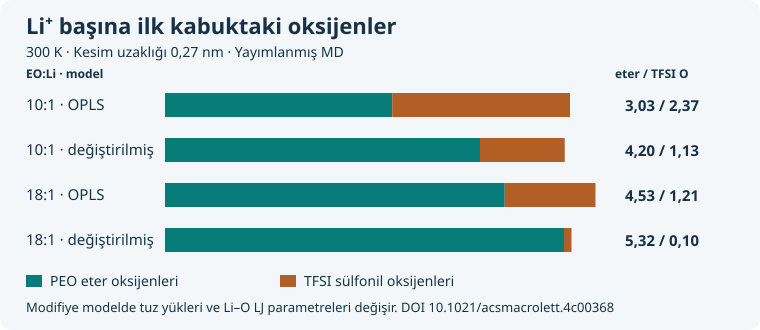

# PEO–LiTFSI reçetesi, EIS ve izleyici difüzyonu

Aynı EO:Li oranındaki iki elektrolitte hangi ölçümler birlikte kullanılabilir?

## Li⁺ çevresinde eter ve anyon nasıl yer değiştiriyor?

**PEO shell · original versus scaled force field** örneğini aç. 300 K, EO:Li = 10 ve 0,27 nm kesim uzaklığında yayımlanmış iki MD modeli karşılaştırılıyor. OPLS modelinden tuz yükleri 0,79 ile ölçeklenmiş ve Li–O kısa mesafe etkileşimleri yeniden ayarlanmış modele geçildiğinde, Li başına eter oksijeni **3,03 → 4,20**, TFSI oksijeni **2,37 → 1,13** oluyor. Toplam **5,40 → 5,33**. Aynı toplam koordinasyona yakın iki model, Li⁺ çevresinde farklı kimyasal ortamlar öngörebiliyor. Bunlar makalede bildirilen simülasyon sonuçlarıdır. [Kaynak, Şekil 3 çevresindeki sonuçlar](https://pmc.ncbi.nlm.nih.gov/articles/PMC11483941/)

Kendi yörüngen için **Continuous Li–oxygen contacts** ekranında aynı oksijenin kesintisiz temasta kalma eğrisini, **Collective charge motion** ekranında ise iyonların birlikte hareketini içeren iletkenliği gör. Her iki ekrandaki başlangıç verisi, hesapları kontrol etmek için oluşturulmuş örnektir. [Girdi biçimleri ve sınama ölçütleri](docs/TRAJECTORY_ANALYSIS.md)

## Uygulamada incele

Pesko ve Zheng örneklerinde EO:Li = 12,5 ve 90 °C sabittir. PEO molar kütlesini, ısıl geçmişi, derişim kaynağını ve veri konumunu karşılaştır. Kendi filminde EIS direnç, kalınlık ve elektrot alanı ile çalışabilir.

## Örnek sonuç

5 kg/mol PEO örneğinde EIS iletkenliği 2 mS/cm. Grafikten yaklaşık okunan izleyici katsayılarıyla σNE ≈ 1,84 mS/cm. 100 kg/mol PEO örneğinde EIS 1,5 mS/cm ve izleyici oranı 0,192. Bu ikinci örnek için eşleşmiş bir molar derişim bulunmadığından σNE hesaplanmıyor.

## Kimyasal yorum

Numune tanımı ve sıcaklığı formülasyon, izleyici ve EIS için eşleşmeli. σEIS/σNE oranı tek başına serbest iyon yüzdesini ya da elektrokimyasal taşınım sayısını vermez.

[Bilimsel yöntem ve veri](docs/PEO_COMPARISON.md) · [Proje ve kullanım](README.md) · [Tek proje kaynak arşivi](../downloads/polymer-electrolyte-lab-0.4.0.zip) · [Tüm projeler](../README.md)
