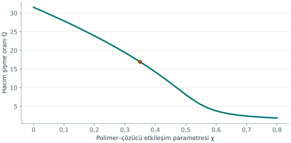

# Polymer Network Lab

Çözücüyle etkileşim ve etkin ağ zinciri yoğunluğu denge şişmesini nasıl belirler?

## Serbest ve izotrop şişen nötr ağ

**Girdiler** — χ = 0,35, νₑ = 100 mol/m³ kuru referans hacmi, çözücü molar hacmi 18 cm³/mol, T = 298,15 K. Kuru tam kalınlık 100 µm.

**Hesaplanan sonuç** — Dengede polimer hacim kesri 0,05904, hacimce şişme oranı V/Vkuru = 16,938, doğrusal gerinim oranı λ = 2,568. Film kalınlığı 256,815 µm ve modelin küçük kaymadaki modülü 96,53 kPa.

**Modelin kapsamı** — Serbest izotrop şişme, nötr ağ ve homojen denge varsayılır. Etkin ağ zinciri yoğunluğunu çapraz bağlayıcı beslemesinden elde etmek için ayrıca bir etkinlik modeli gerekir.

**İncelerken** — Numunede iyonik gruplar, substrata bağlı şişme veya deneysel olarak ölçülmüş etkin ağ yoğunluğu var mı?

Kurulumdan sonra uygulamayı `polymer-network-lab` komutuyla açabilirsin. [Kurulum ve kullanım](README.md) · [Model veya veri aktarımı](docs/SCIENCE.md) · [Doğrulama](docs/VALIDATION.md)

[Bu projenin sürüm 0.2.0 kaynak kodunu ZIP olarak indir](../downloads/polymer-network-lab-0.2.0.zip?raw=true)
