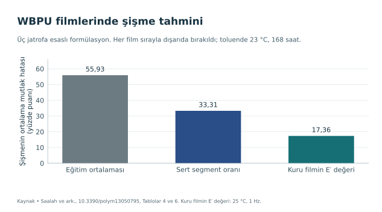

# WBPU eşdeğerleri, çözünmeyen fraksiyon ve şişme

Bir WBPU reçetesinde hangi fonksiyonel gruplar reaksiyona girebilir ve kuru filmin modülü şişme karşılaştırmasına ne katar?

## Uygulamada incele

WBPU reçete örneğinde PEG, PCL-diol, BDO ve izosiyanatı aşamalara göre incele. Ekstraksiyon bölümünde başlangıç, şişmiş ve yeniden kurutulmuş kütlelerin tanımlarına bak. Üç formülasyonlu örnekte her satır dışarıda iken beklenen şişmeyi karşılaştır.

## Örnek sonuç

İdeal diol varsayımında 1 g PEG 20.000, 0,10 mmol OH verir. Aynı kütlede PCL-diol 1.000, 2,00 mmol OH verir. Üç jatrofa esaslı WBPU filminde kuru modül kullanan modelin şişme hatası 17,36 yüzde puanı, reçetedeki sert segment oranını kullanan modelinki 33,31 yüzde puanıdır.

## Kimyasal yorum

Şişme burada toluende ve belirli ekstraksiyon koşullarında ölçülmüştür. Kuru modül ve çözünmeyen fraksiyon fiziksel birleşmelerden de etkilenir. PEG/PCL numuneleriniz için bu üç formülasyondan doğruluk çıkarılamaz.

[Bilimsel yöntem ve veri](docs/WBPU.md) · [Proje ve kullanım](README.md) · [Tek proje kaynak arşivi](../downloads/polymer-network-lab-0.3.0.zip) · [Tüm projeler](../README.md)
