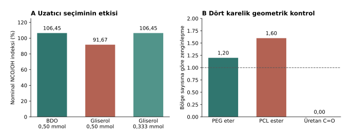

# WBPU eşdeğerleri, çözünmeyen fraksiyon ve şişme

Bir WBPU reçetesinde hangi fonksiyonel gruplar reaksiyona girebilir ve kuru filmin modülü şişme karşılaştırmasına ne katar?

## LDI–PEG/PCL reçetesini incele

**LDI / PEG / PCL · feed and branching** örneğini aç. Örnek 1,65 mmol LDI ve eşit sayıda uzatıcı molekülü içeriyor. 0,50 mmol BDO yerine gliserol seçince nominal NCO/OH indeksi %106,45’ten %91,67’ye iner. Aynı OH eşdeğerinde karşılaştırmak için gliserolü 0,333333 mmol gir. Sulu L-lizin eklenmeden hemen önce ölçülmüş artık NCO miktarını girdiğinde, olası lizin–izosiyanat reaksiyonlarının üst sınırı görünür. Sayılar örnektir. Kaynak, senin makalendeki PEG/PCL–LDI kimyasını ve kullanılan uzatıcıları doğrular.

**NH contact geometry** örneğinde periyodik sınırı geçen N–H···O temaslarını incele. Dört kurulu geometri karesinde PEG eteri için üç, PCL esteri için iki temas sayılır. Her tür için erişime aday zincirler arası çift sayısına göre düzeltilmiş zenginleşme sırasıyla 1,20 ve 1,60’tır. Bu normalizasyon kimyasal bölge sayısını hesaba katar. Geometrik kontrolü kendi GROMACS film yörüngenle değiştirebilirsin.

**Recipe vs MD / FTIR** sekmesinde, aynı spektrum işleme ve numune koşullarında reçete modeline bir temas ölçüsü eklemenin katkısı her formülasyon dışarıda bırakılarak sınanır. Mevcut sekiz formülasyonlu veri sentetiktir. Gerçek kuru film yörüngeleriyle eşleştirilmiş bağımsız ATR-FTIR bileşen alanları bekleniyor. [Yöntem, varsayımlar, sınamalar ve dosya biçimleri](docs/LDI.md)

## Uygulamada incele

WBPU reçete örneğinde PEG, PCL-diol, BDO ve izosiyanatı aşamalara göre incele. Ekstraksiyon bölümünde başlangıç, şişmiş ve yeniden kurutulmuş kütlelerin tanımlarına bak. Üç formülasyonlu örnekte her satır dışarıda iken beklenen şişmeyi karşılaştır.

## Örnek sonuç

İdeal diol varsayımında 1 g PEG 20.000, 0,10 mmol OH verir. Aynı kütlede PCL-diol 1.000, 2,00 mmol OH verir. Üç jatrofa esaslı WBPU filminde kuru modül kullanan modelin şişme hatası 17,36 yüzde puanı, reçetedeki sert segment oranını kullanan modelinki 33,31 yüzde puanıdır.

## Kimyasal yorum

Şişme burada toluende ve belirli ekstraksiyon koşullarında ölçülmüştür. Kuru modül ve çözünmeyen fraksiyon fiziksel birleşmelerden de etkilenir. PEG/PCL numuneleriniz için bu üç formülasyondan doğruluk çıkarılamaz.

[Bilimsel yöntem ve veri](docs/WBPU.md) · [Proje ve kullanım](README.md) · [Tek proje kaynak arşivi](../downloads/polymer-network-lab-0.4.0.zip) · [Tüm projeler](../README.md)
