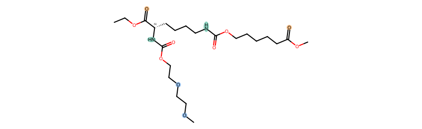

# WBPU/PEtOx pilotunu aç ve başlangıç koşulunu değiştir

**Research pilot** sekmesinde kısa PEG ve PCL parçaları taşıyan LDI diüretanın iki nötr dimerle temasını inceleyebilirsin. [Modelin çizimi](src/polymer_workbench/static/ldi-structure.svg) · [Yörünge başına sonuçlar ve tekrarlama](examples/ldi-blend/README.md)

**Starting pose** menüsünde serbestçe yaklaştırılmış başlangıç ile önceden bir N–H···O=C teması verilmiş başlangıcı karşılaştır. **Partner sequence** ve **Acceptor site** seçenekleri değiştiğinde dört bağımsız başlangıcın sonucu ayrı görünür. İki modelde de yönlendirilmemiş başlangıçların hiçbirinde üretan N–H ile EtOx amid karbonili için ölçütü sağlayan temas görülmedi. Aynı etkileşim başlangıçta kurulunca bazı yörüngelerde korundu. Bu kısa, çözücüsüz model başlangıç konumuna duyarlı. Film afinitesi, lif morfolojisi ve deneysel FTIR doğrulaması için ek veri gerekli.

**Material record → Simulation and experimental counterpart** altında uç grupları, protonlanma durumunu, kuvvet alanını, bağımsız başlangıç sayısını ve hangi deneysel numuneyle karşılaştırma yaptığını kaydet. Boş alanlar denetimde görünür. Her hesap sonucu, o anda seçili numune ve model bilgilerinin bir kopyasını taşır.

**Yorum için:** Öncelikle hangi film numunesinin sınanmasını istersin? Elindeki reçetede LDI esteri, zincir uzatıcı ve kuru film karakterizasyonu tanımlıysa hangi modelin deneyle eşleştirilebileceğini birlikte belirleyebiliriz.

[Proje](README.md) · [Numune ve veri aktarımı](docs/EXCHANGE.md) · [Tüm projeler](../README.md)
