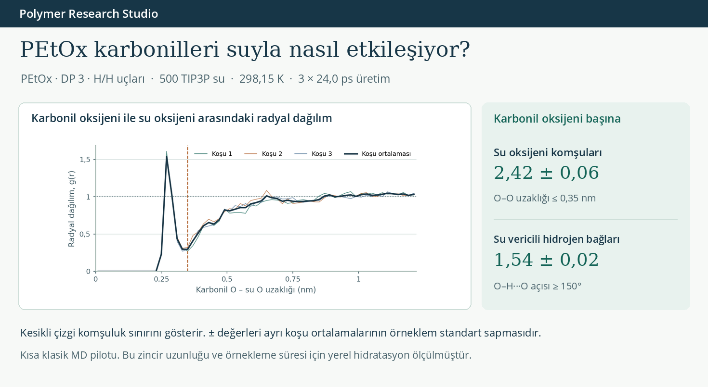

# Polymer–Solvent MD

Polymer Research Studio’nun ikinci bağımsız uygulaması, kullanıcının sonlu zincirini açık su içinde örnekler. Zincir boyutu ve amid karbonillerinin hidratasyonu aynı atomistik yörüngelerden gelir. İlk uygulamadaki atom atom editörde hazırlanan JSON’u içe aktarabilir veya iki bağlantı noktası taşıyan tekrar SMILES’ını ve tekrar sayısını girebilirsiniz. Varsayılan ortam su, 25 °C ve 1 bar.

[Tamamlanmış çalışmanın taşınabilir ekranı](pilot-review.html) · [Analiz verisi](pilot/analysis/observables.json) · [Atom ve bölge düzeyinde hidratasyon](pilot/analysis/site_hydration.csv) · [Üç ham yörünge](pilot/run/) · [Kuvvet alanı ve yükler](pilot/parameters/) · [Birinci uygulama](../polymer-structure-energy/)



## Su etkileşimlerini zaman içinde izleme

Yeni sürümde **3B kare → Yörüngeyi aç** ile kendi hesaplanan tek-zincir çalışmanızdaki koşuyu, hidrasyon suyunu ve yönlü H bağlarını zaman boyunca izleyebilirsiniz. PEtOx için ayrıca iki trimerin temasına su girişini izleten film, uzatılmış simülasyonlar ve uç grubu karşılaştırması yer alır. GitHub HTML kaynak kodunu gösterirse dosyayı indirip tarayıcıda açın.

[İki zincir arasındaki suyun etkileşimli filmi](hydration/contact-viewer.html) · [Uç grubu karşılaştırması](hydration/comparison.html) · [Yöntem, veriler ve yeniden üretim](hydration/README.md)

## Başlatma

Arşivi tamamen açın. Python 3.12 ile proje klasöründe çalıştırın.

```bash
python app.py
```

Tarayıcıda `http://127.0.0.1:8766` adresini açıp “PEtOx” pilotunu seçin. Kayıtlı çalışmayı incelemek için standart Python yeterlidir. Yerel sunucu olmadan aynı kaydı incelemek için indirilen `pilot-review.html` dosyasını tarayıcıda açabilirsiniz. Yeni hesapların bağımlılıkları aşağıdadır.

```bash
python -m pip install -r requirements.txt
```

Yeni kimyasal yapılarda AmberTools gereklidir. Linux’ta, AmberTools araçlarını içeren ACPYPE dağıtımı için `python -m pip install acpype==2026.10.15` kullanabilirsiniz. Alternatif olarak desteklenen AmberTools kurulumunu `AMBERHOME` ile belirtin. Hazır parametre kaydının girdileri eşleştiğinde bu adım atlanır. Yeni parametreleme için en az antechamber, sqm, parmchk2, tleap ve GAFF2 veri dosyalarının erişilebilir olması gerekir. Grafikler ve 3B görünüm çevrimdışı çalışır.

**Kendi polimeriniz.** İlk uygulamadan yapı + enerji JSON’unu indirin ve burada içe aktarın. Alternatif olarak iki uçlu tek tekrar SMILES’ı girin. Örneğin `[*:1]CCN(C(=O)CC)[*:2]` PEtOx tekrarını tanımlar. Tekrar sayısı 3 olduğunda iki uç H ile kapatılır ve model C15H29N3O3 olur. İçe aktarılan belirli uç grupları ve stereokimya kimlik denetiminden geçer. Başlangıç kapsamı su, tam tanımlanmış stereokimya ve 2–100 ağır atom içeren, yüksüz kapalı kabuklu C/H/N/O amidleridir. Uygulama atom tiplerini, parametreleri, konformer yakınsamasını ve kutu boyutunu da denetler. Bu filtreleri geçen farklı bir yapı için yeni hesap yapılabilir. Özel uç grupları ilk uygulamada tam molekül olarak tanımlanabilir.

## Fiziksel model

- **Malzeme ve kuvvet alanı.** İlk uygulamanın sonlu, stereokimyası belirli moleküler grafı, kaynak konformer kimliği ve koordinatları izlenir. AmberTools GAFF2 ve yarı-ampirik AM1-BCC ile atom tipleri ve yükler atanır. Paket, ham yükleri, sayısal yük dengelemesini, analojiyle tamamlanan torsiyonları, topolojiyi ve parametreleme kayıtlarını içerir. Bu aşamanın PEtOx’a özgü deneysel kalibrasyonu yoktur.
- **Sulu kutu.** Bir zincir için su sayısı zincir boyutuna göre seçilir. OpenMM, zincirin özgün Amber etkileşimlerini ve bağ içi ölçeklendirmelerini korur. Üç noktalı rijit TIP3P su, PME elektrostatikleri, 0,8 nm gerçek uzay kesimi, uzun menzil dispersiyon düzeltmesi, H içeren bağlarda kısıt ve 2 fs zaman adımı kullanılır.
- **Bağımsız başlangıçlar.** İlk koşu önceki uygulamanın en düşük bulunan konformerinden, diğer ikisi ayrı ETKDGv3/MMFF94s başlangıçlarından gelir. Her birine ayrı hız, termostat ve barostat tohumları atanır. Her koşuda minimizasyon, 12 ps NPT başlangıç örneklemesi ve 24 ps NPT üretimi vardır. Üretim 0,2 ps arayla kaydedilir. Üç kısa koşu tek kesintisiz 72 ps değildir.
- **Grafikler.** Zincirin kütle ağırlıklı jirasyon yarıçapı bağ grafı boyunca periyodik sınırlar düzeltilerek bulunur. Amid karbonil O–su O radyal dağılım fonksiyonu her karede o anki kutu hacmi ile normalize edilir. Sabit 0,35 nm içindeki su oksijenleri ayrıca sayılır. Yönlü hidrojen bağı için su O···karbonil O ≤0,35 nm ve O–H···O ≥150° ölçütleri birlikte aranır. Raporlanan hidrojen bağlarının donörü sudur. Bir su iki karbonile komşu olabilir. Tek karedeki 3B görünüm bir örnek konfigürasyondur.
- **Kısa oligomer ve uçlar.** H/H uçlandırma PEtOx trimerinde bir sekonder, iki tersiyer amid oluşturur. Karbonil bölgeleri ayrı raporlanır. Bu tanım ve kütle payı deneydeki sentez uç grupları ve derişimle eşleştirilmelidir. Üç koşunun ortalamaları arasındaki örnek standart sapması betimseldir. Zaman serisindeki ardışık kareler bağımsız tekrarlar sayılmaz.

## Sonuçların yeniden kullanımı

Kayıt, yapı tarifini ve konformer kimliğini, çözeltinin koşullarını, kuvvet alanı paketini, motor sürümünü, gerçek başlangıç geometrilerini ve yörünge özetlerini taşır. Aynı yapı ve koşullar tekrar seçilirse eşleşen kayıt açılır. Sıcaklık değişince çözeltinin MD çalışması yenilenir. Başlangıç geometrisi ve kuvvet alanı eşleşen parametre paketi kullanılır. Tek başına saf suyun yoğunluk veya enerji kaydı çözeltide ölçülen büyüklüklerin yerine geçirilmez. Yerel varsayılan kayıt klasörü `~/.polymer-research-studio/polymer-water` olup `--store` ile değiştirilebilir.

Her üretim yörüngesi hem polimeri hem açık suyun bütün atomlarını içerir. `positions_nm` ve `box_nm` nanometre, `time_ps` pikosaniyedir. Tekrar analiz için şu komutları proje klasöründe çalıştırın.

```bash
python trajectory_analysis.py --topology pilot/run/topology.json --out reanalysis pilot/run/seed_13031.npz pilot/run/seed_27011.npz pilot/run/seed_49033.npz
python -m unittest discover -v
```

`pilot/study.json` dosyasında giriş, yöntem, ölçüler, protokol kimliği ve indirilebilir dosya özetleri yer alır. `upstream/` birinci uygulamanın [kaynak sürümünden](https://github.com/burhanbeycan/burhanbeycan.github.io/tree/4097f4086883af4274264d2017a6876a42186a2b/polymer-research/polymer-structure-energy) alınmış zincir ve konformer kodudur. Uygulamanın kendisi DFT çalıştırmaz. Simülasyon motoru OpenMM, açık kaynak parametreleme araçları AmberTools ve zincir kimyası RDKit’e dayanır.

## Fiziksel yorum ve sonraki deney

Bu model için ölçülen büyüklükler yerel hidratasyon ve sonlu zincir boyutudur. Denge çözünürlüğü, bulutlanma sıcaklığı ve Flory–Huggins χ için ayrı termodinamik protokoller gerekir. Öncelikli sınama aynı uç grupları, sıcaklık, kuvvet alanı ve bileşim kontrolüyle bağımsız örneklemeyi uzatmak, sonra uçlandırma ve zincir uzunluğu etkilerini ayırmaktır. Bilimsel karşılaştırma için [PEtOx’un lineer ve çevrimsel zincirleri üzerine atomistik çalışma](https://doi.org/10.1021/acs.macromol.4c00174) ve [GAFF2 yük modeli seçimi](https://doi.org/10.1021/acs.jctc.5c00038) incelenebilir. Bu pilotun grafik ve sayıları paketteki üç yörüngeden hesaplanmıştır.
