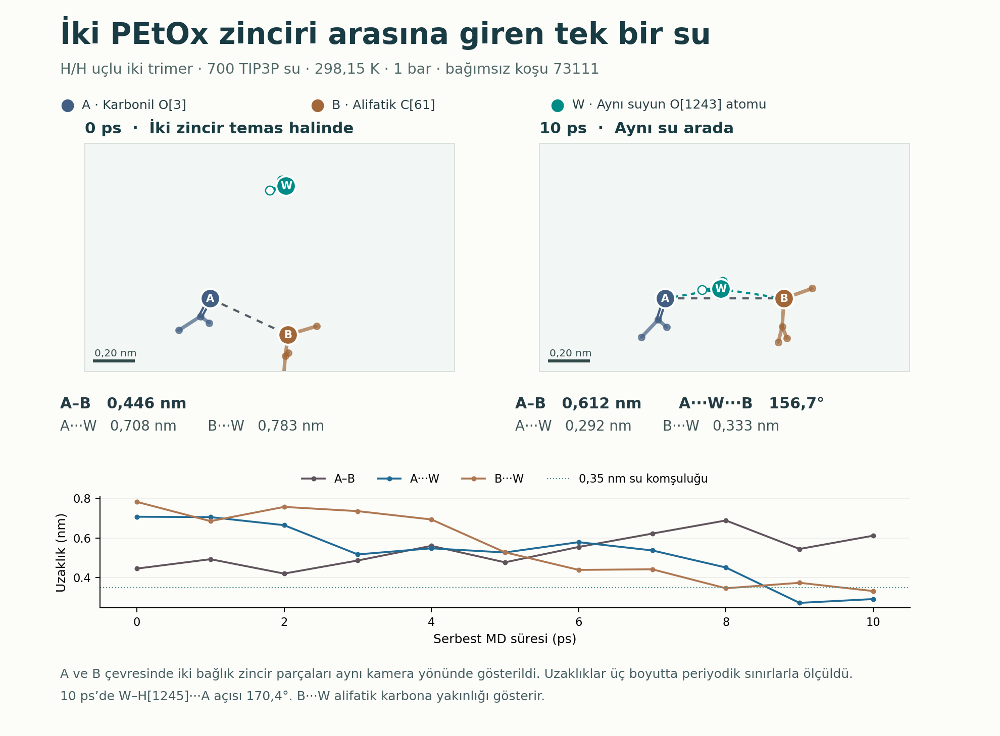

# PEtOx suda · Örnekleme, uç grupları ve temasın ıslanması

[Gerçek karelerle iki zincirin etkileşimli filmi](contact-viewer.html) · [Uç grubu ve örnekleme karşılaştırması](comparison.html) · [Yerel su girişi](results/water_entry.png) · [Film · MP4](media/PEtOx_Suda_Temas.mp4) · [Altı sayfalık rapor · PDF](media/PEtOx_Su_Ornekleme_ve_Temas.pdf) · [Ham veriler](data) · [Sonuç tabloları](results)

HTML dosyalarını indirip bir tarayıcıda açabilirsiniz. Uygulamayı yerel olarak çalıştırınca iki incelemeye ana ekrandan erişilir. Kendi amid oligomerinizin tamamlanmış çalışmasında **3B kare → Yörüngeyi aç** seçeneği kaydedilmiş koşulardan istediğinizi oynatır. Yeşil kesikli çizgiler, suyun donör ve amid karbonilinin akseptör olduğu anlık H bağlarını gösterir. Karbonile en fazla 0,35 nm uzaktaki sular ve bağlı hidrojenleri gerçek atom kimlikleriyle seçilir. En çok 160 kare gösterilir; ekrandaki zamanlar orijinal kayıttandır.

## Üç fiziksel soru

| Deney | Kimya ve koşul | Okunabilecek sonuç |
|---|---|---|
| Tek zincirin örneklemesi | H/H uçlu DP 3 PEtOx, bir zincir ve 500 TIP3P su, 298,15 K ve 1 bar | Önceki üç 24 ps koşunun son karelerinden başlayan üç ayrı uzatma. Her uzatmanın başında yeni hızlarla 12 ps koşullandırma ve ardından 120 ps üretim. |
| Uç grubu karşılaştırması | Aynı DP, sıcaklık, basınç ve su sayısında α-metil/ω-hidroksil zincir | Her iki uç birlikte değişir. Üç bağımsız başlangıç, aynı hazırlık ve örnekleme süreleri. Zincir boyutu, ortak ağır atomların boyutu, uç bölgeleri, karbonil komşuları, yönlü H bağları ve aynı suyun bölgede kalması. |
| İki trimerin temasının ıslanması | İki H/H zinciri, 700 TIP3P su; iki farklı yakın yerleşim | 8 ps konum kısıtlı koşullandırma sonrasında kısıtlar kaldırılır. 60 ps boyunca her 1 ps’de bir zincirler arası temaslar, arayüze yakın sular ve belirli atom çiftlerinin arasına giren su kimlikleri kaydedilir. 0 ps ilk serbest karedir. |



PEtOx’un α-metil/ω-hidroksil uçları için metil tosilat başlatması ve NaOH ile sonlandırma deneysel olarak bildirilmiştir. Bu çalışmadaki yapı o kimyaya göre modellenen belirli bir trimerdir. Zincir mol kütlesi dağılımı, kristalin veya amorf katı, entanglement ve difüzyon sınır tabakası bu kutuların kapsamında değildir. İki DP 3 zincirindeki yerel ıslanma olayı çözünürlük, polimer çözünme hızı veya nedensel bir mekanizma tayini için yeterli değildir. [Uç grubu kaynağı](https://doi.org/10.1039/D2PY00437B) · [Polimer çözünme mekanizmaları](https://doi.org/10.1016/S0079-6700(03)00045-5)

## Yeniden analiz

Ana `polymer-solvent-md` klasöründen Python 3.12 ile çalıştırın. Yeni kimyanın parametrelerinin sıfırdan hesaplanması için ayrıca ana uygulamanın AmberTools kurulumuna bakın.

```bash
python -m pip install -r hydration/requirements.txt
python hydration/experiments/compare_solutions.py --hh hydration/data/hh/run --caps hydration/data/caps/run --pilot pilot/run --out reanalysis --plots
python hydration/experiments/make_hydration_view.py --pair hydration/data/pair --out temas.html
python hydration/test_player.py
```

[Uzatma ve yeniden başlatma](experiments/RESTART.md) · [Karşılaştırmalı analizin tanımları](experiments/analysis_methods.md) · [CROP uçlu modelin kaynağı ve parametreleri](data/caps/README.md)

- Rg kütle ağırlıklıdır ve zincir periyodik hücrede bütünleştirilir. [Amid torsiyonları](results/amide_torsions.csv) ilk metilene doğru aynı O–C–N–C açısını izler. İki uç kimyasının tüm atomları, ortak C15N3O3 ağır atomları ve ortak dokuz omurga atomunun karşılaştırmaları farklı soruları yanıtlar.
- Bir karbonilin yakın su sayısı için su O···karbonil O ≤0,35 nm. Sudan karbonile yönlü H bağı için ayrıca su O–H···karbonil O ≥150°. Uçtaki N–H ve O–H donörleri ayrı izlenir.
- Atom çiftinin yerel olarak ıslanması için önceden temas eden iki ağır atomun açılması ve **aynı suyun** her ikisine ≤0,35 nm mesafede, atom–Ow–atom açısı ≥120° olacak şekilde araya girmesi aranır. İki zincire birden komşu olmak daha geniş bir tanımdır.
- Koşular arası standart sapma, blok ortalamaları, özilinti temelli etkin örnek sayıları ve sıra-normalize bölünmüş R̂ değerleri kayıtlıdır. Kısa seriler çok yavaş hareketleri olduğundan hızlı gösterebilir. [Örnekleme ve belirsizlik rehberi](https://doi.org/10.33011/livecoms.1.1.5067)

## Sayısal özet

Uzatılmış H/H koşularında bütün zincir Rg = 0,375 ± 0,024 nm, α-Me/ω-OH koşularında 0,396 ± 0,027 nm bulundu. Üç koşunun Rg dağılımları yakınsamadı (R̂ 1,91 ve 1,69). Orta amidin O–C–N–C yönelimi ilk modelde üç koşuda da 0°, ikincisinde üç koşuda da 180° çevresinde kaldı. Örneklenmiş uç grubu farkları bu konformasyon farkını da içerir. ω karboniline sudan verilen H bağı ortalaması sırasıyla 1,58 ve 1,29 oldu.

Temas çiftlerinde başlangıçta yakın iki ağır atom arasına tek bir suyun girdiği ilk kayıtlı kareler 10 ve 24 ps oldu. 60 ps sonunda iki çiftte de zincirler arası temas vardı. [Üç boyutlu standardizasyon · GROMACS ve VMD için XTC, GRO, PDB, NDX](results/external-view/README.md) · [Dosya özetleri](SHA256SUMS.txt)
