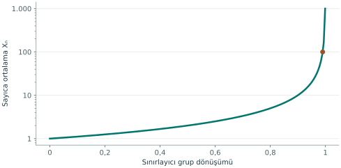

# Polymer Synthesis Lab

Fonksiyonel grup dönüşümü ve başlangıç stokiyometrisi ortalama zincir uzunluğunu nasıl sınırlar?

## İdeal AA + BB kondenzasyonu

**Girdiler** — AA = BB = 0,010 mol, M(AA) = 146,14 g/mol, M(BB) = 116,21 g/mol. Oluşan bağ başına ayrılan küçük molekül 18,015 g/mol. Fonksiyonel grup dönüşümü %99.

**Hesaplanan sonuç** — Molekül başına başlangıç monomeri sayısı Xₙ = 100. Kalan zincir ve serbest monomerlerin toplam madde miktarı 0,000200 mol. Tüm popülasyon için Mₙ = 11.334,015 g/mol.

**Modelin kapsamı** — Hesap ideal doğrusal ve halkalaşmasız büyüme varsayar. Xₙ burada başlangıçtaki AA ve BB moleküllerini tek tek sayar. 1 + p = 1,99 uzunluk dispersitesidir. Verilen dönüşümden hesap yapılır.

**İncelerken** — Belirli bir poliüretan veya poli(2-oksazolin) deneyinde stokiyometrinin, uç grupların ya da dönüşümün nasıl tanımlanmasını istersin?

Kurulumdan sonra uygulamayı `polymer-synthesis-lab` komutuyla açabilirsin. [Kurulum ve kullanım](README.md) · [Model veya veri aktarımı](docs/SCIENCE.md) · [Doğrulama](docs/VALIDATION.md)

[Bu projenin sürüm 0.2.0 kaynak kodunu ZIP olarak indir](../downloads/polymer-synthesis-lab-0.2.0.zip?raw=true)
