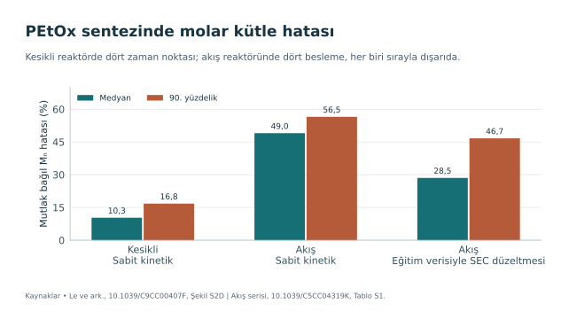

# Reçeteden PEtOx molar kütlesi

Başlangıç beslemesi, sıcaklık ve süreden hesaplanan Mₙ, deneysel SEC sonucuna ne kadar yaklaşır?

## Sıradaki ölçüm için hangi reçete?

**PEtOx · next feed/concentration against four measured flow feeds** örneğini aç. Baeten ve arkadaşlarının aynı mikroreaktör koşulunda elde ettiği dört SEC ölçümünde başlangıç EtOx derişimi 4 M ve beslemeler 15, 30, 60, 120. Uygulama, seçtiğin adaylar arasından yeni derişim ve beslemenin etkisini öğrenmeye en çok katkı sağlayacak bir sonraki ölçümü sıralıyor. Aşağıdaki üç satır, altı ölçülmemiş aday arasındaki ilk üçtür. [Deneysel girdiler, destekleyici bilgi Tablo S1](https://doi.org/10.1039/C5CC04319K)

| Sıra | [EtOx]₀ | EtOx:MeOTs | [MeOTs]₀ | Bilgi kazanımı |
|---|---:|---:|---:|---:|
| 1 | 2,00 M | 120:1 | 0,01667 M | 0,394 nat |
| 2 | 2,00 M | 30:1 | 0,06667 M | 0,353 nat |
| 3 | 2,00 M | 60:1 | 0,03333 M | 0,334 nat |

İlk adayı seçmenin kimyasal gerekçesi, daha önce 4 M derişimde ölçülmüş 120:1 oranını koruyarak derişimi değiştirmektir. Sıralama aday havuzuna ve seçilen bilgi ölçütüne bağlıdır. 2 M için gerçek bir SEC ölçümü pakette bulunmuyor. Bu yüzden düzeltilmiş SEC tahmini ve deneysel tahmin aralığı boş kalır. Tabloya bir ölçüm eklendiğinde aday sıralaması yeniden hesaplanır.

İkinci örnek **PEtOx · synthetic residual recovery**, bilinen katsayılarla üretilen denetim verisinde sistemin derişim ve besleme etkilerini ayrı geri bulduğunu gösterir. Bu örnekteki sayılar yapaydır.

**Yorumlamak için iki konu.** Hangi başlangıç derişimleri aynı reaktör ve çözünürlük koşullarında uygulanabilir? Yeni örneklerde aynı SEC yöntemi, ayrı dönüşüm ölçümü ve tam kromatogram birlikte elde edilebilir mi? [Modelin denklemi ve doğrulama kuralı](docs/ACTIVE_DESIGN.md)

## Uygulamada incele

İki PEtOx deney serisini ayrı çalıştır. Kesikli reaktör için dört zaman noktasını, akış reaktörü için dört beslemeyi incele. Özel CSV ile yayını, seriyi, derişimi veya beslemeyi dışarıda bırakabilirsin.

## Örnek sonuç

Kesikli seride sabit kinetik modelin medyan mutlak bağıl hatası %10,30 (P90 %16,75). Akış serisinde sırayla bir besleme dışarıda bırakıldığında sabit model %49,01, eğitim beslemelerine göre SEC ölçeği düzeltilmiş model %28,54 (P90 %46,66) verdi.

## Kimyasal yorum

SEC sonuçlarının PMMA kalibrasyonunu ve reaktör tipini kaydet. Gözlenen dönüşüm model girdisi değildir. Her kohort tek başlangıç monomer derişimi içeriyor. Yeni derişimde %10 altı hata hedefi açık.

[Bilimsel yöntem ve veri](docs/PETOX.md) · [Proje ve kullanım](README.md) · [Tek proje kaynak arşivi](../downloads/polymer-synthesis-lab-0.4.0.zip) · [Tüm projeler](../README.md)
