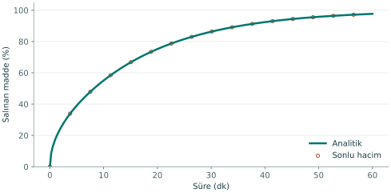

# Polymer Transport Lab

Tam kalınlığı ve difüzyon katsayısı bilinen bir filmde çözünen maddenin ne kadarı salınır?

## İki yüzeyden Fick salımı

**Girdiler** — Tam film kalınlığı 100 µm, başlangıçta homojen derişim, her iki yüzde tam yutucu sınır koşulu. D = 10⁻¹² m²/s, süre 3.600 s, T = 298,15 K.

**Hesaplanan sonuç** — Salınan miktar başlangıçtaki yükün %97,679’u. %50 salım süresi 491,83 s, %90 salım süresi 2.120,21 s.

**Modelin kapsamı** — D sabittir ve kalınlık bu hesap boyunca değişmez. Tek yüzü geçirimsiz destek üzerinde duran filmler farklı bir sınır koşulu gerektirir.

**İncelerken** — Kendi filmin tek yüzeyden mi, çift yüzeyden mi salım yapıyor? Kalınlık kuru halde mi yoksa deney koşullarında mı ölçüldü?

Kurulumdan sonra uygulamayı `polymer-transport-lab` komutuyla açabilirsin. [Kurulum ve kullanım](README.md) · [Model veya veri aktarımı](docs/SCIENCE.md) · [Doğrulama](docs/VALIDATION.md)

[Bu projenin sürüm 0.2.0 kaynak kodunu ZIP olarak indir](../downloads/polymer-transport-lab-0.2.0.zip?raw=true)
