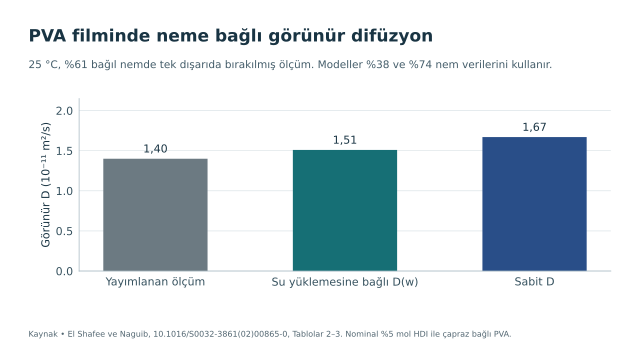

# PVA filminde su difüzyonu

Neme bağlı bir difüzyon katsayısı su alımını hangi koşullarda sabit katsayıdan daha iyi açıklar?

## Uygulamada incele

Denge izotermini ve kinetik ölçümleri ayrı gir. Bir veya iki açık yüz seç. Deneysel HDI/PVA örneğinde iki uç bağıl nemden ara nemi hesapla. Kalınlık sınamasında bir kalınlığa ait bütün eğriler eğitim dışına çıkar.

## Örnek sonuç

25 °C’de ve bağıl nem %61 iken yayımlanan görünür D, 1,40 × 10⁻¹¹ m²/s. Diğer iki nemden türetilen derişime bağlı model 1,51 × 10⁻¹¹, sabit model 1,67 × 10⁻¹¹ m²/s verdi.

## Kimyasal yorum

Bu karşılaştırma bir ara nem noktasına aittir. Kalınlıklar arası örnek sentetiktir. Çözelti dökümünde kalınlığın zamanla değiştiği ve dış kütle aktarımının sınırlayıcı olabildiği durumlar ayrı bir kuruma problemi gerektirir.

[Bilimsel yöntem ve veri](docs/PVA_WATER.md) · [Proje ve kullanım](README.md) · [Tek proje kaynak arşivi](../downloads/polymer-transport-lab-0.3.0.zip) · [Tüm projeler](../README.md)
